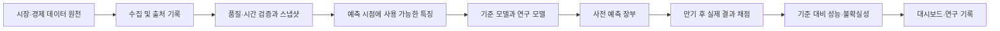

# GMIA — 글로벌 거시·금융시장 인텔리전스

GMIA는 주식, 금리, 환율, 금, 원유, 비트코인과 거시경제가 서로 어떻게 움직이는지 연구하고, 예측을 미리 기록한 다음 실제 결과로 검증하기 위한 개인 연구 프로젝트다. 목표는 미래를 확실히 맞히는 기계를 만드는 것이 아니라, **무엇을 언제 알 수 있었는지**, 모델이 어떤 근거로 예측했는지, 단순한 기준보다 실제로 나았는지를 재현 가능하게 확인하는 것이다. 매매 주문이나 수익 보장 기능은 없다.

## 왜 만들었나

세계 시장은 따로 움직이지 않는다. 미국 금리가 오르면 달러, 채권, 기술주와 신흥국 자산에 서로 다른 영향을 줄 수 있고, 유가 충격은 물가와 수입 비용을 거쳐 기업 실적과 통화정책에 영향을 줄 수 있다. 그러나 두 가격의 동행만으로 원인을 단정하거나, 오늘 수정된 경제지표를 과거에도 알았던 것처럼 사용하면 그럴듯하지만 무의미한 결과가 나온다.

GMIA는 이 문제를 다음과 같이 다룬다.

1. **데이터 출처와 수집 시각 기록:** 수집 결과와 해시를 보존하여 같은 입력을 다시 확인한다.
2. **시점 정합성:** 예측 시점에 알 수 있었던 정보만 사용한다. 관측일, 발표일, 수집일, 수정일은 서로 다르다.
3. **기준과 비교:** 단순한 과거 상승 비율이나 모멘텀보다 나은지 먼저 확인한다.
4. **사전 예측과 사후 채점:** 예측을 먼저 기록하고 만기 후 실제 결과와 비교한다.
5. **실패도 기록:** 좋은 결과만 골라 보여 주지 않고 표본외 검증과 불확실성을 공개한다.

## 현재 가능한 것과 아직 연구 중인 것

| 구분 | 현재 상태 |
|---|---|
| 기존 연구 파이프라인 | Yahoo Finance와 FRED 데이터, 특징변수, 5·20봉 상승확률, 워크포워드 평가와 대시보드가 구현되어 있다. 데이터 및 시장 마감 가정은 실행 경로별로 다르므로 아래 상세 문서를 확인한다. |
| 평가 결과 | v0.3 사전등록 비교에서 통계적으로 지지된 후보는 0개였다. 이는 미래에도 불가능하다는 뜻은 아니지만, 현재 모델에 검증된 우월성이 있다는 뜻도 아니다. |
| 전진 장부 | 기존 장부와 별도의 실험별 장부가 존재한다. 이미 저장된 예측과 채점은 새 실험으로 덮어쓰지 않는다. |
| WTI FinzData | 무료 API 수집과 계약별·연속 가격 대조를 연구용으로 구현했다. 관찰된 계약 전환은 공급자의 공식 롤 일정과 동일하다고 가정하지 않는다. 실제 예측 발행에는 연결하지 않았다. 매일 오전 6시 30분 연구용 자동 수집이 등록되었고 수동 실행을 확인했다. |
| 거시 수정 이력 | FRED/ALFRED와 실제 수집 스냅샷을 별도로 검토한다. 날짜 단위 빈티지나 FRED의 시리즈 갱신 시각만으로 개별 값의 정확한 발표·수정 시각을 증명할 수 없다. |
| 기업 재무·국제정세·시나리오 | 장기 설계와 일부 인터페이스가 있다. 완성된 재무 데이터, 뉴스 기반 예측 또는 검증된 인과 모델은 아니다. |

## 어떻게 작동하나



1. **수집:** 자산별 일별 시계열과 미국 금리 등을 가져온다. 원천의 이용 조건과 지연, 거래일 정의가 다르다.
2. **정제:** 날짜와 중복, 누락, 미완성 봉을 검사한다. 결측을 그럴듯한 값으로 채워 넣지 않는다.
3. **특징 생성:** 수익률·변동성·모멘텀과 금리 등으로 모델 입력을 만든다. 자산별 거래 시간 차이와 과거 데이터 수정에 주의한다.
4. **학습과 예측:** 기준 모델과 통계·기계학습 후보가 각각 5봉과 20봉 뒤 상승 확률을 계산한다. 비트코인은 연중 거래하므로 봉의 의미가 주식시장과 다르다.
5. **검증:** 시간을 거꾸로 섞지 않는 워크포워드 평가를 사용한다. 겹치는 예측 기간과 다중 비교를 고려한다. 과거 홀드아웃을 반복해서 새 가설의 확증 근거로 사용하지 않는다.
6. **전진 기록:** 구현된 실험별 규칙을 만족한 예측을 해당 장부에 기록하고, 만기가 된 예측을 나중에 채점한다. 장부별 규칙과 경로는 다르다.

## WTI: 선물과 롤을 구분하기

**공개 저장소와 로컬 작업의 차이:** FinzData 수집·시점 검증 코드는 이 작업 브랜치에서 확인할 수 있다. 실제 데이터, API 키, 장부와 예약 작업의 실행 이력은 로컬에만 있다. 예측 모델 발행에는 아직 연결되지 않았다.

WTI 선물은 만기가 있는 여러 개별 계약으로 거래된다. 연속 시계열은 특정 규칙으로 계약을 교체해 만든 연구용 시계열이므로, 계약이 바뀌는 날의 두 가격 차이를 실제 일간 수익률로 단순 처리하면 안 된다. 과거 연속 가격을 나중의 롤 차이로 조정한 자료는 당시 알려지지 않은 정보를 과거에 섞을 수 있다.

2026-10-29 실제 무료 API 검증에서는 연속 가격 22건, 개별 계약 가격 831건을 받았고 연속 가격 22건이 각각 해당 개별 계약의 가격과 일치했다. 2026-10-13에 `CLX26 → CLZ26` 전환이 관찰됐으며 같은 날 두 계약의 가격이 있었다. 이는 그 시점에 수집한 **공급자 응답에 대한 확인**이며, 모든 과거 롤과 공식 롤 규칙의 검증은 아니다. 무료 가격 이력은 응답상 최근 30일이다.

응답의 `preliminary`와 `final`은 공급자 상태이며, 각 데이터 행의 실제 최초 공개·수정 시각은 응답에 없다. CME는 [일일 공보](https://www.cmegroup.com/market-data/daily-bulletin.html)의 일반적인 예비·최종 갱신 일정을 제공하지만 이것은 FinzData의 개별 행 공개 시각을 증명하지 않는다. 따라서 스냅샷의 **실제 수신 시각 이후에만** 사용하도록 하고, 수집 전 과거로 소급하지 않는다. 조정되지 않은 연속 자료라도 향후 수정 가능성이 있다.

FinzData의 [무료 이용 조건](https://finzdata.com/terms)은 개인 연구에 한정되며 원자료의 재배포를 제한한다. 키, 원본 데이터, 예측 장부와 백업은 공개 저장소에 올리지 않는다. CME 웹사이트의 직접 자동 추출 및 모델 사용에는 별도 권리 제한이 있으므로 이 프로젝트의 FinzData 조회와 혼동하지 않는다.

### 경로와 보존

- 로컬 프로젝트: `global-macro-intelligence-agent/` (개별 작업 위치는 환경에 따라 다름)
- 새 WTI 연구 스냅샷: `data/operations/source_research/finz-wti-<UTC 시각>-<식별자>/`
- 응답별 원본, 수신 시각, 해시, 점검 결과를 저장한다. 기존 스냅샷을 덮어쓰지 않는다.
- WTI 수집 스크립트: `scripts/collect_finz_wti.py`. `FINZDATA_API_KEY`가 필요하다. 키를 코드나 Git에 넣지 않는다.
- WTI 시점 검증 함수: `gmia.features.finz_wti_pit.features_at`. 수집 시각보다 이른 의사결정, 오래된 자료, 최신 두 봉 중 잠정치, 계약 변경, 평일 결측 가능성, 계약별·연속 자료 불일치와 파일 해시 불일치를 거부한다. 휴일도 결측 가능성으로 보수적으로 거부할 수 있다. 이 함수는 독립 연구용이며 기존 발행 파이프라인에 등록되어 있지 않다.
- 스냅샷 비교: `python scripts/compare_finz_wti.py --before <이전폴더> --after <이후폴더>`는 두 수집본의 계약·가격·상태 변화를 비교한다. 변경이 발견돼도 두 수집 시각 사이에 일어났다는 사실만 알 수 있고, 정확한 공개·수정 시각을 뜻하지 않는다.
- 자동 수집: Windows 작업 스케줄러의 `GMIA-FinzData-WTI-Research`가 매일 06:30 로컬 시각에 연구용 수집을 실행한다. 컴퓨터가 꺼져 있으면 그 시각에 실행되지 않고, 다시 가능해질 때 지연 실행된다(로그인 상태에서만 실행). 수집은 예측이나 채점을 실행하지 않는다.
  - **코드 위치:** 2026-10-30부터 작업은 메인 작업 폴더가 아니라 **전용 git worktree `C:\dev\etc-ops`**(특정 커밋에 고정된 detached HEAD)의 `run_finz_wti.ps1`을 실행한다. `-DataProject C:\dev\etc\global-macro-intelligence-agent`로 스냅샷과 로그는 메인 프로젝트의 `data\`에 쌓인다. 그래서 메인 폴더에서 브랜치를 바꿔도 작업이 바뀌거나 깨지지 않는다. 변경 전 작업 정의는 `data\operations\logsinz_wti	ask-backup-20261030T064129Z.xml`에 백업했다.
  - **로그:** 실행마다 `data\operations\logsinz_wtiinz-wti-<UTC>.log`에 코드·데이터 위치, 커밋, 수집기 출력, 종료 코드(0 성공, 1 수집 실패, 2 키·환경 문제, 3 수집기 없음)가 남는다. 키 값은 남지 않는다.
  - **불완전한 스냅샷:** 수집은 `.finz-wti-<id>.partial`에 쓰다가 manifest까지 끝나면 `finz-wti-<id>`로 이름을 바꾼다. 중간에 끊긴 수집은 `.partial`로 남는다.
  - **수집 코드 갱신:** 메인 폴더에서 커밋한 뒤 `git -C C:\dev\etc-ops checkout --detach <커밋>`으로 worktree를 옮긴다. 갱신하지 않으면 작업은 계속 고정된 커밋의 코드로 실행된다. 새 설치는 worktree 안에서 `scripts\install_finz_wti_schedule.ps1 -DataProject <메인 프로젝트>`로 한다(같은 이름의 기존 작업은 덮어쓰지 않음).
- 인증: 사용자 환경변수 `FINZDATA_API_KEY`에 키를 저장했다. 이 값은 사용자 계정에서 접근 가능한 일반 환경변수이며 암호화된 비밀 저장소가 아니다. 키는 코드·Git·스냅샷에 기록하지 않는다.
- 기존 장부는 `data/ledger/` 및 `data/operations/` 아래 각 실험별 경로에 별도로 보존한다. 새 데이터를 받는 것과 예측을 발행·채점하는 것은 별개다.

## 다음 단계

실제 공급자 공개·수정 시각과 롤 규칙을 더 확인하고, 독립된 장기 시점별 이력을 쌓아야 한다. 모델 후보에 WTI를 새로 도입할 때는 기존 사전등록을 고치지 않고 별도 계획을 먼저 등록하고, 표본외 성능과 전진 평가를 거쳐야 한다. 과거 데이터가 짧거나 발표 시각이 불명확하면 예측에 사용하지 않는다.

아래는 기존 문서와 실행 명령이다. 이전 버전의 설명이 위 현황과 다를 때는 실제 코드, 각 사전등록, 최신 감사 문서 및 위의 제한을 함께 확인한다.

---


# GMIA — Global Macro Intelligence Agent

> 실제 금융 데이터로 학습하고, **학습에 쓰지 않은 미래 구간에서 자신의 예측력을 검증하는** 개인용 글로벌 경제 예측 시스템
> 단계: **v0.4 + 데이터 신뢰 기반 (2026-10-28 실데이터 로컬 실행 확인, 실제 만기 채점 대기)** · 언어: 한국어 · Python 3.11+

> ⚠️ 투자 참고용 연구 도구입니다. 매수·매도 추천이 아니며 실제 주문·자동매매 기능이 없습니다. 확률은 과거 데이터로 학습한 모델 출력이며 미래를 보장하지 않습니다.

## 2026-10-28 심층 재설계·신뢰성 구현

전체 GMIA의 목표와 현재 경계를 [비전](docs/architecture/VISION.md)에 정리했다. 이번 변경은 **불변 수집 스냅샷·실행 입력 추적·장부 보호·수동 백업**이며 새 예측모델이나 성능 개선 주장이 아니다.

- [최신 코드 감사·위험/재현](docs/architecture/CURRENT_STATE_AUDIT.md)
- [11개 논리 계층·Mermaid·API/화면](docs/architecture/SYSTEM_ARCHITECTURE.md)
- [PIT/이중시간 스키마·현재 구현 경계](docs/architecture/POINT_IN_TIME_DATA_MODEL.md)
- [공식 데이터 API·권리/인증 조사](docs/architecture/DATA_SOURCES_AND_LICENSES.md)
- [시장/기업 재무](docs/architecture/MARKET_AND_FUNDAMENTALS.md) · [사건 파이프라인](docs/architecture/GEOPOLITICAL_EVENT_PIPELINE.md)
- [연구·전진검증](docs/architecture/FORECASTING_AND_EVALUATION.md) · [시나리오](docs/architecture/SCENARIO_ENGINE.md)
- [운영·백업](docs/architecture/DEPLOYMENT_AND_OPERATIONS.md) · [보안](docs/architecture/SECURITY_PRIVACY.md)
- [의존성·수용조건별 로드맵](docs/architecture/ROADMAP.md) · [실제 실행 검증](docs/architecture/VALIDATION.md)

새 수집본은 `data/raw/**/<series>.snapshot.json`과 `_snapshots/`에 저장하며 `load_series`가 해시를 확인한다. 기존 Parquet+sidecar도 `legacy_unverified`로 읽는다. 포인터가 손상되면 자동 대체하지 않는다. 스냅샷은 **수집 당시 파일의 보존**이고 과거 공개시점 PIT를 인증하지 않는다. 기본 모델의 날짜 join과 파라미터·사전등록은 유지된다.

```powershell
python scripts/backup_ledger.py --destination data/backups/forward-YYYYMMDD-HHMM.sqlite3
```

기존 백업을 덮어쓰지 않으며 DB online backup·무결성 검사를 수행한다. snapshot/모델 파일은 별도 보존한다. 장부·데이터·백업은 모두 로컬 전용이며 public Git에 올리지 않는다. 외부 배포는 활성화하지 않았다. 현재 WTI 연구용 수집 예약 상태는 위 WTI 절을 확인한다.

## 무엇을 하나
1. Yahoo Finance(yfinance)와 FRED에서 **실제** 일별 시장·금리 데이터를 받아 정제·저장한다.
2. 자산별 특징변수(수익률·변동성·이동평균 이격·RSI·타 자산·상관계수·미국 금리)를 만든다.
3. 자산마다 **향후 5봉·20봉 수익률이 양수일 확률**을 15개 후보(기준모델 2, 머신러닝 3, 그 보정·축소판 6, 사전 등록 경제 가설 4)로 추정한다.
4. **시간순 워크포워드 검증 + 최근 2년 홀드아웃**으로 성능을 평가하고, 기준모델 대비 개선을 **HAC 검정 + 다중비교 보정(BH-FDR)**으로 판정한다. 못하면 그대로 표시한다.
5. 최신 데이터 기준 예측을 학습기간·데이터 기준일·검증 성능·신뢰도와 함께 출력한다.
6. Streamlit 대시보드로 시장 현황·상관관계·예측·백테스트를 보여준다.

## 빠른 시작 (Windows PowerShell)
```powershell
cd global-macro-intelligence-agent
py -3.12 -m venv .venv
.\.venv\Scripts\Activate.ps1
python -m pip install -e ".[dashboard,dev]"
# 검증된 버전 그대로 재현하려면: python -m pip install -r requirements-lock.txt; python -m pip install -e . --no-deps

python scripts\run_all.py                 # 데이터 수집 → 특징변수 → 워크포워드 평가 → 최신 예측 → 보고서
python -m pytest                          # 단위 테스트 (미래정보 유출 검사 포함)
python scripts\score_ledger.py             # 예측 만기 후, 새로 받은 실제 데이터로 장부 채점
streamlit run dashboard\streamlit_app.py  # 대시보드 (http://localhost:8501)
```
macOS/Linux는 `python3 -m venv .venv && source .venv/bin/activate` 후 같은 명령을 쓰면 된다.

| 명령 | 하는 일 |
|---|---|
| `python scripts\fetch_data.py` | 데이터만 새로 받기 (`data/raw/`, 수집 요약 `data/raw/collection_summary.json`) |
| `python scripts\run_all.py --no-fetch` | 저장된 데이터로 평가·예측 + 최초 예측의 append-only 기록 (중복 기록 불가) |
| `python scripts\score_ledger.py` | 실제 만기 봉의 완료 및 새로 받은 데이터 확인 → append-only 채점, 252개 고정 비교 결과는 `data/ledger/forward_significance.csv` |
| 결과 | `artifacts/runs/<run_id>/` (+ 최신 복사본 `artifacts/latest/`): `report.md`, `forecasts.json`, `metrics_summary.csv`, `fold_metrics.csv`, `reliability.csv`, `oos_predictions.parquet`, `equity_curves.parquet`, `config.yaml`, `run_meta.json` |
| 로그 | `artifacts/logs/gmia.log` (수집 실패 포함) |

`data/`와 `artifacts/`는 Git에 올리지 않는다(`.gitignore`). 모든 실행은 설정 파일 사본, 데이터 기간, 패키지 버전, 코드 커밋을 `run_meta.json`에 남긴다.

선택: `.env.example`을 `.env`로 복사하고 무료 `FRED_API_KEY`를 설정하면 기본 경로에서 미국 거시지표의 ALFRED 날짜별 빈티지를 수집할 수 있다. 날짜별 빈티지만으로 개별 값의 정확한 발표·수정 시각이나 실제 당시 수집 여부가 증명되지는 않는다. 별도 공개 시각 및 수집 증거가 없는 모델 입력은 주의해야 한다. 키가 없으면 기본 경로에서 거시지표를 모델 입력으로 쓰지 않는다.

## 데이터 출처

| 키 | 출처 / 티커 | 실제 정체 | 통화 | 예측 기간 단위 |
|---|---|---|---|---|
| SPY | Yahoo `SPY` | S&P 500 **ETF**, 수정종가(배당 재투자 ≈ 총수익) | USD | 거래일 |
| QQQ | Yahoo `QQQ` | NASDAQ-100 **ETF**, 수정종가 | USD | 거래일 |
| KOSPI | Yahoo `^KS11` | KOSPI **가격지수**(배당 제외) | KRW | 거래일 |
| NIKKEI | Yahoo `^N225` | 닛케이225 **가격지수** | JPY | 거래일 |
| GOLD | Yahoo `GLD` | 금 현물 추종 **ETF**(보수만큼 괴리) | USD | 거래일 |
| BTC | Yahoo `BTC-USD` | 비트코인 현물, UTC 일봉 | USD | **달력일** |
| USDKRW | Yahoo `KRW=X` | 환율(상승 = 원화 약세) | KRW | 거래일 |
| USDJPY | Yahoo `JPY=X` | 환율(상승 = 엔화 약세) | JPY | 거래일 |
| WTI | Yahoo `CL=F` | **근월물 선물 연속**(롤오버 갭 존재, 2020-04-20 음수가격 → 결측 처리) | USD | 거래일 |
| DXY | Yahoo `DX-Y.NYB` | 달러인덱스 (특징변수 전용) | — | — |
| DGS2 / DGS10 / DFF | FRED fredgraph CSV | 미 2년·10년 국채금리, 연방기금 실효금리 (%) | — | — |
| CPIAUCSL / UNRATE / INDPRO / M2SL | FRED | 미 CPI·실업률·산업생산·M2 (**수정치 포함**) | — | — |

- 기간: 2005-01-01부터(금 ETF 상장 이후). BTC는 Yahoo 데이터가 시작되는 2014-09-17부터.
- Yahoo 데이터는 Yahoo 이용약관상 개인 연구용이며 yfinance는 비공식 클라이언트다. FRED 데이터는 일부 시리즈에 별도 저작권 조건이 있을 수 있다.
- 검토했지만 쓰지 않은 공급원: **Stooq**(2026-10 기준 자바스크립트 브라우저 검증을 요구해 스크립트 접근 불가, 우회하지 않음), **ALFRED 웹 CSV**(봇 차단 페이지 반환 → API 키 방식만 지원).
- 수집 실패 시 오류를 로그에 남기고 해당 자산을 건너뛴다. **가짜 데이터로 대체하지 않는다.**

## 데이터 규칙 (미래정보 유출 방지)
- **미완성 봉 제거:** 각 시장의 마감 시각(+15분) 전에 받은 당일 봉은 버린다(예: 장중 받은 WTI 당일 봉).
- **정제:** 날짜 중복 제거(마지막 값 유지), 시간대 제거·정렬, 0 이하 종가 → 결측, 극단적 변동은 **삭제하지 않고 표시만** 한다(실제 폭락도 정보이므로). 품질 리포트는 `data/raw/market/<자산>.meta.json`.
- **예측 시점:** 행 t = 대상 자산의 t일 종가 시점. 자기 자산 특징은 t까지 사용한다.
- **다른 시계열은 t보다 엄격히 이전 날짜까지만** 쓴다(as-of strict join). 시장마다 거래 시간대가 달라 같은 날짜라도 아직 모를 수 있기 때문이다(예: SPY의 t 종가 시점에 BTC의 t일 UTC 봉은 미완성). FRED 금리도 하루 늦게 반영한다.
- **비거래일:** 각 자산은 자기 거래일 달력을 쓰고, 다른 자산 값은 위 규칙으로 붙인다. 상관계수는 공통 평일 달력에서 **수익률**로 계산한다(가격 수준 상관 아님).
- **거시지표:** 월간 지표는 발표일·수정 이력과 실제 수집 시각을 구분해야 한다. FRED 공개 CSV의 최신 수정치를 과거에 소급해 모델에 쓰면 안 된다. 기본 경로는 키가 있으면 날짜 단위 ALFRED 빈티지를 사용하지만 정확한 시각 및 당시 입수 여부는 별도 확인이 필요하다.
- **뉴스:** 현재 뉴스 감성을 과거에 소급 적용하지 않는다. 뉴스 모듈은 인터페이스만 있고 학습 변수로 쓰지 않는다.

## 모델과 검증

**라벨:** `y_h(t) = 1[수정종가(t+h) / 수정종가(t) − 1 > 0]`, h = 5·20봉(BTC는 달력일, 나머지는 해당 시장 거래일).

| 모델 | 내용 |
|---|---|
| B1 과거 상승비율 | 학습 구간의 상승 비율을 그대로 확률로 사용 |
| B2 모멘텀 규칙 | 직전 h봉 수익률이 양수/음수일 때 학습 구간의 조건부 상승 비율 |
| M1 로지스틱 회귀 | 중앙값 대체 + 표준화 + L2 규제(C=0.05) — 전처리는 학습 구간에서만 적합 |
| M2 HistGradientBoosting | 얕은 트리(depth 3), 큰 잎 최소 표본(100) |
| M3 LightGBM | 7잎, 최소 표본 100, 행·열 샘플링 |
| M1~M3 + 축소 (v0.3) | 학습 구간 마지막 20%를 보정 블록으로 떼어(퍼징) p' = b + λ(p − b), λ∈[0,1]은 보정 블록 Brier 최소 |
| M1~M3 + Platt (v0.3) | 같은 보정 블록에서 y ~ logit(p) 로지스틱 회귀 |
| H1~H4 가설 (v0.3) | 추세(`mom_12_1`, `ma_gap_200`) · 변동성 레짐(`vol_20`, `vol_ratio`) · 금리 레짐(`us10y_2y`, `us2y_chg60`, `us10y_chg60`) · 단기 반전(`ret_5`, `ret_1`) 각각 표준화 로지스틱 회귀 + 축소 |

하이퍼파라미터는 고정(튜닝 루프 없음) — 수천 개의 잡음 섞인 일별 표본에서 선택 편향을 줄이기 위해서다. v0.3 후보의 설정·판정 기준은 검증 코드 작성 전에 [docs/preregistration_v0.3.md](docs/preregistration_v0.3.md)로 커밋했다(`933048d`). v0.2 모델(B1·B2·M1~M3)은 가설 특징을 보지 않으며, v0.3 실행에서 v0.2 지표가 소수점까지 그대로 재현된다.

**분할 (랜덤 분할 금지):**
- 확장형 **워크포워드 검증**: 처음 5년 학습 → 다음 1년 검증 → 학습 구간을 늘려 반복 (검증 폴드: BTC 5개, 나머지 15개)
- **최종 홀드아웃**: 최근 2년. 모델 선택에 쓰지 않고 마지막에 한 번만 채점
- **퍼징:** 학습 표본은 라벨 종료일(t+h)이 검증 시작일보다 앞서야 한다 → 경계마다 약 h개 표본 제거
- **모델 선택:** 검증 폴드를 합친 Brier 점수가 가장 낮은 모델. 홀드아웃에서 우연히 좋았던 모델을 사후에 고르지 않는다.

**평가 지표:** Accuracy, Balanced accuracy, ROC-AUC, Brier, Log loss, ECE(보정오차), 신뢰도 곡선(10구간), 폴드별 성과(실패 시기 표시).

**경제적 유용성(예측 성능과 별도 보고):** `P(상승) > 0.5`이면 보유, 아니면 현금(0%). 신호는 t 종가에 계산하고 **다음 봉 종가에 체결**(지연 1봉), 포지션 변경 1회당 10bp(수수료+슬리피지). 누적수익률·최대낙폭·변동성·노출 비율을 매수 후 보유와 비교한다. h봉 확률로 매일 리밸런싱하는 단순 점검용 규칙이며 권장 전략이 아니다.

**기준모델 대비 유의성 (v0.3):** 홀드아웃 관측별 Brier 차이(후보 − B1)의 평균을 Newey–West HAC(시차 = h) 표준오차로 단측 검정하고, B1을 뺀 14개 후보 × 18개 조합 = 252개 검정 전체에 Benjamini–Hochberg FDR q = 0.10을 적용한다. **'지지됨' = BH 유의 + 검증 구간에서도 B1보다 나음.** 결과는 `significance.csv`, 가설 계수 부호는 `sign_consistency.csv`.

**신뢰도 표시:** 기준모델이 선택되거나, 홀드아웃에서 B1보다 나쁘거나, AUC < 0.55이거나, 사전 등록 기준(지지됨)을 통과하지 못하면 "참고 신뢰도 낮음". 모두 통과해도 최고 등급은 "참고 신뢰도 보통(잠정)"이다(홀드아웃 재사용 문제, 아래 참고).

## v0.2 결과 (2026-10-26 실행, 데이터 2026-10-23~26까지)

**요약: 머신러닝 모델은 어떤 자산·기간에서도 검증 구간에서 단순 기준모델을 이기지 못했다.**
- 18개 조합(9개 자산 × 2개 기간) 중 15개에서 B1(과거 상승비율), 3개에서 B2(모멘텀: BTC 5·20일, USD/KRW 5일)가 선택됐다.
- 검증 Brier: 기준모델 약 0.217~0.255, 학습 모델 약 0.244~0.297 — 학습 모델이 일관되게 나빴다(과신된 확률). 학습 구간 안에서는 로지스틱 회귀 AUC 0.57(SPY 5일)이지만 미래 구간에서는 0.5 안팎이다.
- 홀드아웃에서 B1을 이긴 선택 모델은 B2 두 개뿐이며 차이는 매우 작다(BTC 5일 0.2514 vs 0.2517, USD/KRW 5일 0.2483 vs 0.2501).
- 홀드아웃에서만 좋아 보인 학습 모델도 있었지만(QQQ 20일 로지스틱 Brier 0.2100 vs B1 0.2234, AUC 0.67) 검증 구간에서는 나빴으므로 채택하지 않았다. 사후 선택은 미래정보 유출이다.
- 파이프라인 점검: 미래 수익률에 잡음을 섞어 일부러 넣으면 모델이 홀드아웃 AUC 0.75 이상으로 잡아낸다 → 일부 신호 검출 배선이 작동함을 보인 검사다. 구현 오류나 데이터 시점 누출이 전혀 없다는 증거는 아니다.

→ 현재 출력되는 5일·20일 상승확률은 대부분 **과거 상승비율**이며 방향 예측 신호가 아니다. 대시보드와 보고서는 이를 '참고 신뢰도 낮음'으로 명시한다. 수치는 데이터를 새로 받으면 달라진다.

## v0.3 결과 — 보정·축소와 사전 등록 가설 (2026-10-27 실행, v0.2와 같은 데이터)

**요약: 사전 등록 기준을 통과한 후보는 252개 검정 중 0개다.** 보정·축소는 ML의 과신을 없앴지만, 그 결과 대부분 기준모델과 거의 같은 확률을 내게 됐다. 경제 가설 4개도 다중비교 보정 후 기준모델보다 낫다는 증거를 보이지 못했다.

| 항목 | 결과 |
|---|---|
| 홀드아웃 Brier가 B1보다 낮은 조합 | 252개 중 103개 |
| 보정 전 p < 0.05 | 4개 (모두 검증 구간에서는 B1보다 나빴음) |
| BH 유의 (q = 0.10) | **0개** (가장 작은 보정 p = 0.935) |
| 지지됨 | **0개** |
| v0.2 모델 재현 | B1·B2·M1~M3 지표 180행이 v0.2와 완전히 같음 (최대 차이 0) |

**보정·축소의 효과** (홀드아웃 평균 Brier 차이 vs B1, 18개 조합 평균, 음수가 좋음):

| 모델 | 원본 | + Platt | + 축소 |
|---|---|---|---|
| M1 로지스틱 | +0.0073 | +0.0043 | −0.0003 |
| M2 HGB | +0.0164 | +0.0047 | −0.0002 |
| M3 LightGBM | +0.0168 | +0.0043 | +0.0002 |

- 축소는 과신 문제를 거의 다 없앴다. 다만 축소 계수 λ가 **0으로 잘린 폴드가 ML 39~47%, 가설 모델 46~55%**다. 보정 블록에서 보면 원래 확률을 그대로 믿는 것보다 상승비율을 그대로 쓰는 편이 낫다는 뜻이다.
- λ = 0이면 예측이 '학습 구간 앞 80%의 상승비율'이 되어 B1(전체 구간 상승비율)과 조금 달라진다. 그래서 특징변수와 무관하게 작은 Brier 차이가 생긴다(예: KOSPI 20일에서 후보 5개가 똑같이 −0.0034). 이 차이를 신호로 해석하면 안 된다.
- 검증 구간에서 B1을 이긴 조합 수(18개 중): H3 금리 레짐 5, H4 단기 반전 4, M1+축소 3, B2 3, 나머지 ≤ 1.
- 선택 결과: B1 10개, H3 4개(KOSPI 5일, BTC 5·20일, USD/JPY 5일), H1·H4·M1+축소·M2+Platt 각 1개. **지지된 것은 없으므로 18개 예측 모두 '참고 신뢰도 낮음'이다.**

**가설 계수 부호** (검증 폴드 중 사전 기대 부호와 같은 비율, 설명용):
- 금(GOLD)과 미 10년 금리 60일 변화: 5·20일 모두 **100% 음수**로 H3 기대와 일치했다. GOLD 5일 H3는 252개 중 보정 전 p가 가장 작았다(0.021). 하지만 검증 구간 개선이 없었고 BH 보정 후 0.935다.
- SPY 5일: 단기 반전(`ret_5`, `ret_1`)과 2년 금리 상승(`us2y_chg60`)이 100% 음수로 기대와 일치했다. 반면 20일에서는 2년 금리 계수가 대부분 **양수**로, 기대와 반대였다.
- H1 추세: `mom_12_1`과 `ma_gap_200`이 서로 반대 부호로 갈리는 경우가 많다(예: QQQ 20일 `ma_gap_200` 100% +, `mom_12_1` 100% −). 두 변수가 강하게 상관돼 있어 **개별 계수 부호 검정이 사전 등록 단계부터 해석하기 어려운 설계였다.** 문서를 사후에 고치지 않고 이 한계로 기록한다. H2의 `vol_20`·`vol_ratio`도 같은 문제가 있다.

**한계 — 홀드아웃 재사용:** 이 홀드아웃(최근 2년)은 v0.2에서 이미 집계 결과를 봤다. 앞으로 같은 기간에 후보를 계속 추가해 시험하면 우연히 좋아 보이는 결과를 찾을 위험이 커진다. 다음 판정은 **2026-10-27 이후 데이터의 전진 검증**으로 해야 한다.

## v0.4 전진 검증 장부 (최초 구현 당시 기록; 최신 검증은 VALIDATION 참조)

기존 v0.2·v0.3의 최근 2년 홀드아웃은 여러 번 확인했으므로 새로운 가설의 검증으로 재사용하지 않는다. v0.4는 과거 성적표를 만드는 기능이 아니라 **실제 미래를 기다렸다가 채점하는 장부**다.

- **사전 등록 선행:** [docs/preregistration_v0.4.md](docs/preregistration_v0.4.md) 를 코드 작성 전 별도 커밋(`331c42e`)으로 고정했다. 이후 임계값·후보·검정 방식을 성과를 보고 바꾸지 않는다.
- **예측 기록:** `scripts/run_all.py` 실행 시 모든 **사용 가능한** 후보의 (기준일, 자산, h, 모델, 확률, 기록 UTC 시각, 코드 SHA)를 `data/ledger/forward.sqlite3`에 저장한다. 같은 키에 대해서는 **최초 기록만** 보존한다. 데이터 없는 H3 등 후보는 가짜 확률을 만들어 저장하지 않는다.
- **만기 채점:** `python scripts/score_ledger.py` 실행 시 원자료에서 **h번째 실제 봉의 완료 시각(+15분)**을 확인한다. 기록 시각이 만기 이후라면 제외한다. 만기 뒤 새로 수집된 원자료가 있어야 처음 채점하고, 이미 채점된 결과는 이후 원자료 수정으로 덮어쓰지 않는다.
- **발행 적시성 (v0.4.1):** 기록 시각이 **기준일 다음 봉의 완료 시각 이후**인 예측은 '늦은 발행(`stale_issue_excluded`)'으로 채점과 통계에서 영구 제외한다. 결과 경로의 일부가 이미 공개된 뒤 기록된 예측이기 때문이다. 오래된 데이터로 `run_all --no-fetch`를 다시 돌려 생긴 예측이 여기에 해당한다. 기록은 감사용으로 남는다. 규칙은 코드 변경 전에 [docs/preregistration_v0.4.1.md](docs/preregistration_v0.4.1.md)(`1092429`)로 등록했다. 등록 시점에 알려진 장부의 채점 행은 0개였다.
- **평가:** 자산 9 × 기간 2 × B1 제외 후보 14 = **252개 비교**. 같은 기준일에 기록된 B1-후보 쌍이 **500개 이상, 관측 span 540일 이상**일 때만 Newey–West HAC(`lag=h`)와 BH-FDR(`q=0.10`)을 적용해 '지지됨'을 평가한다. 충족하지 않은 쌍은 p=1로 계산하여 전체 검정 수를 보존한다.
- **대시보드:** '전진 검증' 탭에는 예측 수·만기 채점 수·Brier·표본 부족 여부·지지된 모델 수를 표시한다.
- **변경 금지:** `data/ledger/`는 로컬 전용이며 `.gitignore` 적용 대상이다. 장부를 Git에 업로드하거나 PR #2 설명을 변경하거나 실행 스케줄을 설치하려면 사용자 결정이 필요하다.
- **실험 정직성:** 바로 뒤에 모든 15개 모델의 확률이 기록됐다는 이유만으로 실증적 예측력이 생긴 것은 아니다. 만기된 독립적인 관측이 축적될 때까지 0개의 '지지됨'을 성능 실패라고 단정하지 않는다.

**신규 환경 재현:** 위 PowerShell 설치 후 `python scripts/run_all.py`로 먼저 실데이터를 수집하고 예측을 기록한다. 이후 적절한 시간 경과 후 `python scripts/fetch_data.py`로 **새로 수집한** 자료를 확보하고 `python scripts/score_ledger.py`로 채점한다. 단순히 과거 기록을 소급해 생성해서는 안 된다.

**최초 구현 당시 검증 기록(최신 상태는 [VALIDATION](docs/architecture/VALIDATION.md)):** GitHub Actions [GMIA unit tests 실행 #40429223134](https://github.com/cyw0927/etc/actions/runs/40429223134)에서 Python 3.12 패키지 설치·모듈 컴파일·`python -m pytest -q`가 **통과**했다(2026-10-27). 이 세션에는 사용자의 로컬 실데이터(`data/raw/`)가 없으므로 `run_all.py --no-fetch`, 실제 Yahoo/FRED 데이터 재수집, 신규 실제 예측 발행·만기 채점의 전체 실행은 **미검증**이다. Windows PC에서 추가 검증이 필요하다.

## 폴더 구조
```text
global-macro-intelligence-agent/
├── README.md · CLAUDE.md · pyproject.toml · requirements-lock.txt · .env.example · .gitignore
├── configs/default.yaml          # 자산·기간·검증·전략 설정 (실행마다 사본 저장)
├── prompts/                      # v0.1 원본 프롬프트 3개 (보존)
├── docs/preregistration_v0.3.md · preregistration_v0.4.md · preregistration_v0.4.1.md
│                               # 모델 검증 및 전진 검증 장부 사전 등록
├── src/gmia/
│   ├── data/                     # yfinance·FRED 수집, 정제, 미완성 봉 제거, 저장, 빈티지 처리
│   ├── features/                 # 특징변수·라벨, as-of strict 조인
│   ├── models/                   # 기준모델 2 + ML 3 + 보정·축소 6 + 가설 4, 최신 예측·신뢰도
│   ├── evaluation/               # 워크포워드 분할·퍼징, 지표, 전략 백테스트, HAC 검정·BH-FDR
│   ├── news/                     # 뉴스 데이터 계약·출처 정책 (미구현)
│   ├── pipeline.py · report.py
│   └── utils/
├── scripts/                      # fetch_data.py, run_all.py, score_ledger.py
├── dashboard/                    # streamlit_app.py + app_pages/ (시장·상관·예측·백테스트·국제정세)
└── tests/                        # 미래정보 유출·분할·정제·모델·지표·전략 테스트 (합성 데이터는 테스트 전용)
```

## 구현 현황
| 기능 | 상태 |
|---|---|
| 실데이터 수집·정제·저장 (10개 시장 시계열, 금리 3, 거시 4) | ✅ |
| 특징변수·라벨, 미래정보 유출 방지 | ✅ (테스트 포함) |
| 기준모델 2 + 로지스틱·HGB·LightGBM | ✅ |
| 워크포워드 + 홀드아웃, 퍼징, 지표·보정·전략 비교 | ✅ |
| 확률 보정(Platt)·축소, 사전 등록 가설 H1~H4 (v0.3) | ✅ — 지지된 후보 0개 |
| 기준모델 대비 HAC 검정, 다중비교 보정(BH-FDR), 계수 부호 점검 (v0.3) | ✅ |
| 전진 검증(예측 기록 누적 후 만기 채점) | ⚠️ v0.4 코드 및 테스트 추가, 실제 Windows 실행 검증 대기 |
| 최신 예측 출력(기준일·학습기간·성능·신뢰도) | ✅ |
| Streamlit 대시보드 (A~E 화면) | ✅ (E는 '추후 구현' 표시) |
| 미국 거시지표 빈티지 입력 | ⚠️ 코드·단위테스트 완료, **API 키 없이 실데이터 실행은 미검증** |
| 한국·일본·중국 거시지표, 국가 간 금리차 | ❌ 미구현 (수집 인터페이스는 FRED 모듈 패턴으로 확장 가능) |
| 기업별 PER/PBR | ❌ 미구현 |
| 해외 뉴스 수집·LLM 분류 | ❌ 인터페이스·출처 정책만 |
| 실거래·자동주문 | 🚫 범위 밖 (구현하지 않음) |

## 다음 개발 우선순위
1. **v0.4 실제 실행 검증:** Windows에서 pytest, run_all --no-fetch, score_ledger를 실행하고 신규 실제 예측이 장부에 기록되는지 확인한다. 이후 미래 결과가 나올 때만 판정한다.
2. 새 가설은 새 사전 등록 문서로 등록하고 전진 데이터로 판정한다. H1·H2처럼 상관된 변수 쌍은 하나로 줄여 계수 해석이 가능하게 설계한다.
3. FRED API 키로 거시 빈티지 실행 검증, 한국은행 ECOS·일본 e-Stat 등 공식 API 추가
4. 뉴스 모듈: 합법적 RSS 수집 → 시점 기록 저장 → 충분히 쌓인 뒤 뉴스 특징 유무 비교 실험
5. 기업별 PER/PBR, 한·일·중 거시지표

## 버전 이력
- **v0.1 (2026-10-26)** 가상 시나리오 PoC: `prompts/` 3개 문서, 가상 실험 001 (PR #1, 미병합)
- **v0.2 (2026-10-26)** 실데이터 예측 MVP. v0.1의 '코딩 금지·시뮬레이션 전용' 지침은 사용자 지시로 대체됐다.
- **v0.3 (2026-10-27)** 사전 등록(`docs/preregistration_v0.3.md`) 후 보정·축소 6개와 경제 가설 4개 검증, HAC 검정·BH-FDR 도입. 지지된 후보 0개.

- **v0.4 (2026-10-27)** 전진 검증 사전 등록 → 최초 발행 예측의 append-only SQLite 기록 → 별도 만기 채점 명령 → 고정 252개 검정 및 대시보드 화면 추가. **실행 검증 대기.**
- **v0.4.1 (2026-10-28)** 독립 검증에서 늦게 기록된 예측(기준일 24일 뒤, 20봉 중 18봉 공개 후)이 채점되는 빈틈을 발견했다. 사전 등록(`docs/preregistration_v0.4.1.md`) 후 '발행 적시성' 채점 규칙과 테스트 4개를 추가했다.
