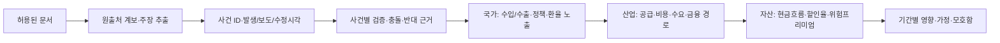

# 사건 기반 국제정세 인텔리전스

상태: **설계**. 현재 `news/schema.py`는 기사 수준 계약과 출처 정책만 있다. 수집·군집·LLM 분류·지도는 미구현이다.

## 수집·중복·증거

허용 소스 목록→공식 발표/합법적 RSS/구독 API→문서 ID와 원출처 링크→발생/보도/수정/수집시각→정규화→사건 후보 군집→주장별 근거 연결→대상별 파급 해석→검토/공개 순서다. 한국 매체의 국제뉴스 2차 기사는 기본 수집원에서 제외하고 한국 공식 경제/공시는 허용한다. 외신의 명성은 독립 확인을 대신하지 않는다.

canonical URL·provider ID·제목/시간·실체·유사도는 중복 탐지 단서다. 같은 Reuters 원문을 인용한 세 매체는 독립 근거 1개다. 사건 자동 병합은 시간·위치·당사자가 충돌하면 보류하고 split/merge 이력을 남긴다. 원문 저장 권한 없으면 URL·허용 제목/최소 발췌·해시·라이선스만 보관한다. 유료벽·ToS·robots 접근 제한을 우회하지 않는다.

`claim_type = observed_fact / party_claim / independently_verified / commentary / unverified`를 주장별로 부여한다. 독립 검증은 서로 다른 원출처가 같은 구체적 사실을 뒷받침하는지 확인한다. 공식 발표는 '공식 주장이 존재함'의 증거이며 내용 전부가 사실이라는 판정은 아니다. 수정·철회는 새 evidence version과 반박 링크로 남긴다.

## 대상별 영향 계약

`event_id, target_type(country/sector/asset), target_id, horizon, sign(positive/negative/ambiguous), intensity(ordinal), confidence, channel, assumptions, counterevidence_ids, invalidation_conditions, author_model_version, reviewed_at`를 필수로 한다. sign은 뉴스 논조가 아니라 해당 대상의 경제적 효과다. 수치 확률이 아니며 강도와 신뢰도를 혼동하지 않는다.

예: 실제 원유 공급 손실이 확인된 경우 수입국 비용↑/경상수지 악화 가능, 유지 생산자의 가격 이익, 항공 비용↑, 정유는 재고·마진에 따라 혼합이다. 금은 실질금리와 달러 경로, BTC는 레버리지 청산과 유동성에 따라 모호할 수 있다. 공급 우려만 있고 실제 손실이 없으면 같은 충격 크기를 적용하지 않는다. 이미 반영된 가격 움직임을 재차 예측 신호로 더하지 않는다.

## LLM 격리와 검증

외부 기사/공시는 비신뢰 데이터다. 텍스트 속 지시·URL·도구 실행을 따르지 않으며 수집 worker의 권한/키를 LLM에 주지 않는다. 구조화 JSON schema, evidence ID 참조, 근거가 없는 주장 거부, prompt/model/version/비용을 기록한다. 정량 확률 테이블에 대한 쓰기 권한을 주지 않는다. 과거 기사시점 archive와 revision이 없으면 뉴스 피처 백테스트에 사용하지 않는다.

수용조건: 같은 통신사 재인용 10건→origin 1개, 상반 주장 공존, 기사 정정 전후 재현, 미확인 사건 수동 보류, 키·유료전문 미보관, 서로 다른 대상의 양방향 효과, LLM 지시문 공격 격리, 허용 목록 외 요청 거부. 초기에는 공식 문서 1개+허용 외신 소스 1개로 시작하고 검토된 50~100 사건의 분류 평가표를 만든다. 이 숫자는 예측 통계 검정 기준이 아닌 라벨 품질 작업량 제안이다.
