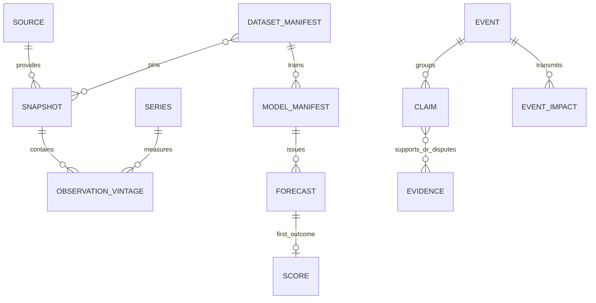

# PIT·이중시간 데이터 계약

## 서로 다른 시간

`observation_start/end`는 경제활동 또는 거래 봉의 기간, `release_at`은 최초 공개, `revision_at`은 해당 수정본 공개, `ingested_at`은 GMIA가 실제 받은 시각이다. `system_valid_from/to`는 DB에 그 버전을 알고 있던 기간이다. 데이터 공급자의 기준시간대·캘린더·버전과 문서 근거를 함께 보존한다. 관측월 1일을 발표일로 쓰지 않는다.

실시간 재현의 가용시각은 `max(해당 빈티지 공개시각, 수집시각, 시장 봉 완료시각+버퍼)`이다. 역사적 발표시점 연구는 ingest 조건을 분리할 수 있지만 그 경우 '당시 GMIA가 수집함'을 주장하지 않는다. 날짜만 제공되는 ALFRED 빈티지는 정확한 일중 발표시각의 증명이 아니다. 보수적 지연 가정은 `conservative_lag`로 표시하고 정확 PIT와 섞지 않는다.

이번 `data/pit.py::Availability`는 **향후 어댑터용 계약**이다. `exact_release`이고 공개시각이 decision 이하일 때만, live replay에서는 ingest도 decision 이하일 때만 적격이다. 기존 `features/build.py`의 날짜 join을 바꾸지 않았으므로 기존 모델이 이 계약을 이미 따른다고 말할 수 없다.

## 목표 DB 스키마 (PostgreSQL 이전 시; 현재는 파일+장부)

| 테이블 | 핵심 열·키·제약 |
|---|---|
| source_registry | source_id PK, authority, terms_url, terms_checked_at, redistribution_status, budget/rate_policy |
| instruments | instrument_id PK, vendor_ticker, asset_type, quote_base/quote_currency, timezone, calendar_version, adjustment/roll_policy |
| series | series_id PK, source_id FK, unit, frequency, seasonal_adjustment, transformation_version |
| source_snapshots | snapshot_id PK, source_id FK, request_hash(키 제외), fetched_at, ingested_at, payload_hash, manifest_uri, rights_status |
| observation_vintages | series_id+observation_period+vintage_id PK, value/null_reason, unit, release_at, revision_at, snapshot_id FK, system_valid_from, supersedes_id |
| dataset_manifests | dataset_id PK(hash), snapshot_ids, cutoff, feature_schema_hash, label_schema_hash, calendar_version, quality_policy |
| model_manifests | model_id PK(hash), family, config_hash, seed, training_dataset_id FK, artifact_hash, environment_hash, code_sha |
| runs | run_id PK, dataset_id/model_manifest FK, started/finished, state, failure_reason; 완료 후 append-only |
| forecasts / scores | v0.4 기존 기본키·최초값 유지. 이전 시 UTC 타입/FK, 발행·채점 manifest는 별도 추가 테이블 |
| filings / financial_facts | accession+concept+unit+period+dimension+version, accepted_at, amended_from |
| events / claims / evidence | event_id, claim_id, source_document_id, origin_cluster_id, 유효/시스템 시각 |
| event_impacts | event_id+대상+기간+version, 방향·강도·가정·반증·신뢰도 |
| job_attempts / incidents | task_key+attempt, 시작/종료, 입력 snapshot, error_class, 재시도 예정 |

경제적 유효시각과 시스템이 인지한 시각의 이력을 UPDATE로 지우지 않고 신규 버전과 supersedes 관계를 추가한다.

## 이번 스냅샷 구현

`data/raw/market/SPY.snapshot.json`이 `_snapshots/SPY/<uuid>/manifest.json`을 가리킨다. manifest는 Parquet/meta SHA256, 행·열, ingest/source/fetch 시각을 가진다. 데이터→메타→manifest를 새로 만들고 fsync한 뒤 같은 볼륨에서 포인터만 원자적으로 바꾼다. 도중 실패하면 기존 포인터가 유지된다. UUID는 수집 단위 ID이며 내용 해시는 별도다.

읽을 때 manifest와 두 파일의 해시·형태를 확인하고 불일치면 중단한다. 기존 Parquet+sidecar는 `legacy_unverified`로 읽지만, 새 포인터가 손상된 경우 구형 파일로 자동 대체하지 않는다. `run_meta.input_snapshots`는 시장·금리·macro_realtime 입력 포인터를 보존한다. `load_snapshot(path, pointer)`로 당시 수집본을 읽을 수 있다.

정제 후 수집본이며 HTTP 응답 원문·과거 발표 이력·피처·모델 바이너리 전체 저장은 아니다. 각 공급원 읽기 결과를 고정하므로 모든 소스가 동일 수집 배치인 것은 아니다. Windows의 일시 파일 공유 오류는 최대 6회 재시도하고 최종 실패를 숨기지 않는다. 전원 단절 때 디렉터리 엔트리의 영속성까지 보장하지 않는다. 운영 DB는 OneDrive 동기화 폴더 밖에 둔다.

## 수용조건과 후속 과제

- 재수집 후에도 과거 포인터에서 같은 값 복원. Parquet의 index frequency 속성은 저장 계약 밖이다.
- 데이터/meta/manifest 변조, 경로 이탈, 잘못된 포인터 검출.
- 포인터 공개 직전 실패와 동시 쓰기에서 data/meta 혼합 금지.
- release·revision·ingest 이전 이용 차단; lag/unknown을 exact로 인정하지 않음.
- 다음 구현: 원응답 저장, 소스/시간/단위 필수 스키마, 오래된 자료 SLA, 영업일 누락, 빈티지 중복·취소·결측 수정, 완료 run manifest, 모델·피처 hash, SQL migration과 읽기 전용 role.
