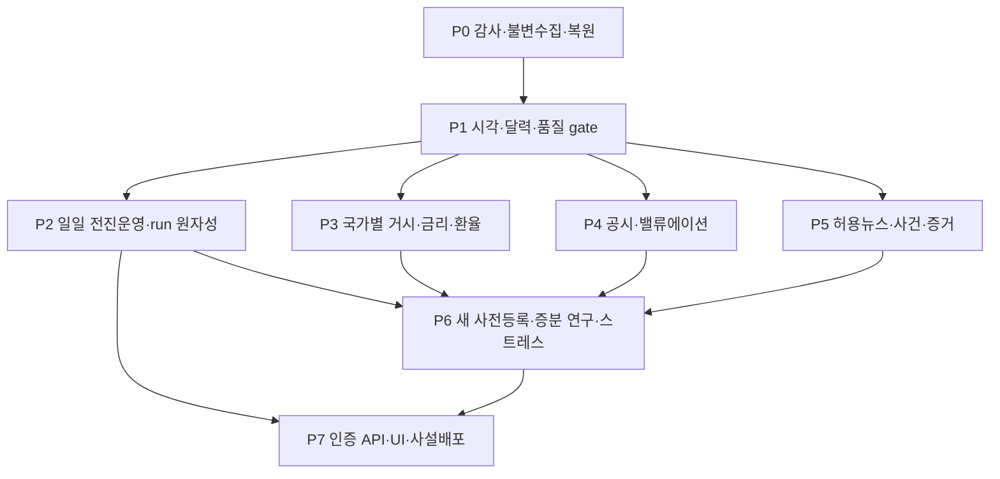

# 의존성 기반 구현 로드맵

이번 PR은 신뢰성 기반의 첫 수직 슬라이스다. 전체 GMIA 완성/예측력 확보가 아니다. 기간 추정은 인력/키/권리/빈티지에 따라 달라 숫자 일정 대신 수용조건으로 진행한다. 데이터·장부는 public GitHub에 올리지 않는다.

## 지금 있는 기능 / 다음 기반 / 연구 이후 확장

지금: 기존 ETL·15후보·5/20봉·과거 검증·로컬 최초 예측과 채점·연구 UI. 이번 추가: 소스 snapshot/검증, Availability 계약, run 입력/code manifest, 일반 SQL 수정 방지/수동 백업.

다음 기반: 실제 발표시각·calendar·staleness gate, raw 응답/score snapshot FK, 완료 run 원자성, 영구 DB·복원과 단일 writer. 연구 이후 확장: 추가 horizon/분포·다국가 공통요인·조건부 스트레스와 production API. 기업/사건의 설명 기능은 예측 성공과 별도로 검증 가능하지만 예측확률 입력으로 승격하려면 증분 연구가 필요하다.

| Epic | 파일·DB·API 작업 | 의존성과 수용조건 | 성능·비용·보안/누출 위험 |
|---|---|---|---|
| P0 이번 범위 | `data/store.py,pit.py`, `evaluation/backup.py,forward.py`, `pipeline.py`, `scripts/backup_ledger.py`, `tests/test_data_trust.py` | 17 실제수집→13 입력 snapshot→18 forecast/270 row, 변조·중단·동시쓰기·백업복원 검사 | 메모리에 Parquet 직렬화하므로 대형 소스엔 streaming 필요; hash는 권리/PIT 증명이 아님 |
| P1 PIT·품질 | `sources/registry.py`, `domain/observations.py,instruments.py`, `data/quality.py`, `db/migrations/001_sources.sql`; sources/series/vintages/snapshots | P0; 발표 전·정정 전 접근 불가, 한국/일본/미국/DST/휴일/BTC 누락일 테스트, 오래된 cache 학습 차단 | 과거 PIT 미제공은 제외/가정; full schema가 미래데이터로 결정되지 않게 고정 |
| P2 전진운영 | `workers/{forecast,score}.py`, `db/jobs.py`, `ops/runbook.md`; runs/job_attempts/score_sources; GET scorecard/health | P1; crash 주입·동시run·중복·run 완료pointer·restore·미채점 재처리; 기존 252/500/540 유지 | 배치 전체 원자성/키누출 redaction/비동기 job lease; 운영경로와 RPO 결정 필요 |
| P3 다국가 거시 | `sources/{ecos,kosis,boj,estat,imf,oecd,bis}.py`, `features/macro_pit.py`; observation_vintages | P1; 국가별1~2개 source부터 수작업 발표값/단위 대조, CPI/정책금리/성장/환율과 release calendar | 공급원별key/quota/DSD·정정·publication lag; 새 피처 평가 전 별도 등록 |
| P4 기업가치 | `sources/{edgar,dart}.py`, `fundamentals/{facts,ratios,universe}.py`; filings/facts/constituents; GET companies | P1; 한미각2개사 최초/정정·단위/기간·TTM 검증, 공시 링크 표시 | 컨센서스/forward PER 계약 없음; 차원·회계·survivorship·수작업 비용 |
| P5 사건 | `news/{ingest,dedup,claims,impacts}.py`; events/claims/evidence/impacts; GET events | P1; 허용원천만, 원출처 중복·수정/철회·상충주장·공격텍스트 검증, 검토표 확보 | 원문저작권·구독비·LLM비용/주입; LLM의 forecast DB write 금지 |
| P6 연구/시나리오 | `research/{datasets,regimes,event_study}.py`, `scenarios/engine.py`; experiment/model/dataset manifests | P2 및 사용 모듈; 새 protocol 선행커밋, baseline·nested/purge·증분 전진검증, 정성/통계 분리 | 반복탐색/다중검정·레짐 불확실성·비식별; 후보 무제한 확대 금지 |
| P7 제품/운영 | `api/{routes,schemas,auth}.py`, `ops/{Dockerfile,compose.yaml}`, UI read models | P2 필수, 나머지 준비된 것만; 인증·read-only·source rights filter·stale 화면·백업 복원·부하 테스트 | 월 예산·인증/공개범위·정식 재배포 권한 확정 후 배포. 이번엔 생성/활성화 안 함 |

## 작업 가능한 단위 티켓

- T1 (P1): instrument master와 release timestamp gate. A03/A04/A05/A06/A11 처리. 입력 schema·비교군·시간대/달력 버전 문서부터 고정하고 legacy 모델과 분리한다.
- T2 (P2): 실행 완료 manifest·job lease·score source FK·원장 version별 탐색 보고. A07/A09/A12/A14. 기존 첫 행을 수정하지 않고 연결 메타를 별도 추기한다.
- T3 (P3): ECOS 가이드/권리 확인+BOJ 공식 API 최소 어댑터. 샘플 응답과 publication 메타 수작업 대조. 확인 안 된 범위는 설명용.
- T4 (P4): EDGAR/DART 최초/정정공시 fact 스키마와 TTM. forward consensus 없는 상태를 그대로 표시한다.
- T5 (P5): 허용 문서→사건/주장/원출처 계보→대상별 영향. 수집권 확보 전 외신 crawler 만들지 않는다.
- T6 (P6/P7): 후속 실험 사전등록/반복검정 계획과 사설운영 수용조건. 모델 확대/배포는 선행 요건 통과 후.

각 티켓은 schema/문서→작은 adapter/worker→실데이터 대조→회귀 테스트→별도 PR 순서로 나눈다. 기존 PR #1/#2는 보존하고 이번 PR은 #2 head를 base로 하는 stacked PR이다. #2가 바뀌면 충돌/의존 diff를 확인하고 main에 중복 구현을 합치지 않는다.

## 사용자만 결정할 항목

1. 개인 전용/인증된 사설/공개 서비스 중 범위와 허용 사용자.
2. 데이터/뉴스 정식 계약과 월 총비용/LLM 예산 상한.
3. 운영 장부·snapshot 영구 경로, 오프사이트 백업 대상·보관기간.
4. 배포 지역/공급자와 인증 방식; 실제 배포·스케줄 활성화는 별도 승인.

이 결정 전에도 P1의 공개 문서 조사·로컬 계약/검증 구현은 진행 가능하다.

## 생성한 GitHub 작업

[T1 PIT/달력 #3](https://github.com/cyw0927/etc/issues/3) · [T2 운영/복원 #4](https://github.com/cyw0927/etc/issues/4) · [T3 공식거시 #5](https://github.com/cyw0927/etc/issues/5) · [T4 재무 #6](https://github.com/cyw0927/etc/issues/6) · [T5 사건 #7](https://github.com/cyw0927/etc/issues/7) · [T6 연구/운영 gate #8](https://github.com/cyw0927/etc/issues/8). 각 이슈에 파일 범위·의존성·수용조건을 기록했다.
