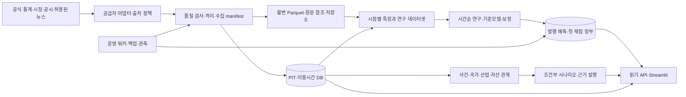

# 다층 연구·운영 아키텍처

상태: 아래 목표 구조는 **설계**다. 실행 가능한 현재 코드와 이번 변경은 VISION/VALIDATION을 기준으로 구별한다. 논리적 계층마다 서비스를 만들지 않는다. 초기에는 하나의 Python 패키지, DB, 불변 파일 저장소를 UI와 워커가 공유한다.



## 계층별 계약·의존성과 운영주기

| 층 | 입력→출력 계약 | 의존성·주기 | 실패 시 동작 |
|---|---|---|---|
| Source/Provenance | 공급자 응답→원천ID·권리·요청범위·수집시각·해시 | 허용 목록; 소스별 제한 | 재시도 후 격리, 합성 대체 금지 |
| PIT/Bitemporal | 관측기간·빈티지 공개·수집→시점 조회 | 출처/공개 달력; 발표 직후 | 공개시각 불명은 설명용 또는 제외 |
| Cross-Asset | 가격·금리→단위·통화·캘린더 확정 수익률 | PIT·instrument master; 일별 | 결측/스테일 명시, 휴일 0수익 오인 방지 |
| Fundamentals | 공시→접수시각별 재무 fact·밸류에이션 | 법인·종목 매핑·회계기간; 공시별 | 정정은 신규 버전, 추정치 대체 금지 |
| Event Intelligence | 허용 문서→사건·주장·독립근거·전파경로 | 법적 허용/원출처; 추후 15~60분 | 링크/최소 메타데이터, 분류 보류 |
| Econometric | 동결 데이터→관계·레짐·이벤트 스터디 | 표본/변환 선언; 주간 연구 | 인과/예측으로 승격 금지 |
| Forecast/Calibration | 동결 피처·모델→확률·분포·버전 | 사전등록·검증; 일별 발행 | 실패 후보만 누락, 이유 기록 |
| Scenario | 충격가정→조건부 전파·범위·반증 | 통계 추정/정성 가정 분리; 요청별 | 미검증 방향·크기는 정성 표시 |
| Audit/MLOps | manifest·예측→불변 발행/첫 채점·운영지표 | 영구 DB; 수집/발행/채점마다 | 성공 공개 전 커밋, 불완전 run 비공개 |
| Product/API | 읽기 모델→일관된 as_of·출처·불확실성 | 완료 run ID; 요청별 | 오래된 값 경고·빈 상태 |
| Deployment/Ops | 동일 이미지·비밀키→사설 실행 | 로컬→Compose→선택된 호스팅 | 수집/학습/뉴스 실패 격리·복원 |

## 파일 경계와 의존성

현재 `data/`, `features/`, `models/`, `evaluation/`, `pipeline.py`, `dashboard/`를 유지한다. 다음 확장은 `src/gmia/sources/{registry,ecos,kosis,boj,edgar,dart}.py`, `domain/{instruments,observations,events,filings}.py`, `research/{datasets,regimes,event_study}.py`, `workers/{ingest,forecast,score}.py`, `api/{routes,schemas}.py`, `db/migrations/`, `ops/`다. 현재 파일들이 존재한다는 뜻이 아니다.

어댑터는 도메인 계약만 반환하고 학습모델을 import하지 않는다. 연구는 고정 dataset ID를 입력받는다. 워커는 orchestration과 작업 상태만 관리한다. API는 데이터를 수집하거나 학습하지 않으며 UI 요청이 장부를 변경하지 않는다. 모델은 뉴스 설명 객체를 입력받지 않는다.

## 핵심 시퀀스

```mermaid
sequenceDiagram
 participant W as 수집 워커
 participant P as 공급자
 participant S as 불변 저장소
 participant D as 운영 DB
 participant F as 예측 워커
 W->>P: 허용된 요청과 rate limit
 P-->>W: 응답·공개/빈티지 메타데이터
 W->>S: 원자료·메타·manifest 기록
 W->>D: snapshot 등록·품질 승인
 F->>D: decision_at 기준 적격 snapshot 조회
 F->>S: 고정 입력 읽기·hash 검증
 F->>D: run manifest와 최초 예측 원자적 발행
 Note over F,D: 현재는 SQLite 최초 예측만 원자적; run 파일 전체 원자성은 후속 과제
 W->>P: 만기 이후 새 관측 요청
 W->>D: 새 snapshot 승인
 F->>D: 만기·발행시각·새 관측 검증
 F->>D: 첫 score INSERT; 기존 결과 유지
```

## 읽기 API와 사용자 화면 (미구현 설계)

모든 응답은 `as_of_utc`, `data_cutoff_utc`, `run_id`, `status`, `sources`, `warnings`를 포함한다. cursor pagination·최대 기간·행 제한을 둔다. 데이터 재배포 권한 없는 응답은 요약/링크만 허용한다.

| API | 화면과 의미 | 승인 조건 |
|---|---|---|
| GET /v1/overview | 세계경제 변화·데이터 노후화·불확실성 | 최신 완료 run만 |
| GET /v1/countries/{iso}/regime | 국가별 성장·물가·정책과 레짐 범위 | 관측과 추정 구분 |
| GET /v1/markets; /assets/{id}/forecasts | 시장 현황·통화·모델별 확률 | 기준모델 동시 표시 |
| GET /v1/assets/{id}/scorecard | 발행일별 성적·표본수·보정·252개 비교 | 발행/채점 전후 불변 |
| GET /v1/companies/{id}/fundamentals | 실제 공시·기간·TTM·가치평가 분모 | 공시시각과 가격 기준 일치 |
| GET /v1/events; /events/{id}/evidence | 지도·타임라인·원출처/주장·검증 | 기사 수를 독립근거 수로 표시 금지 |
| POST /v1/scenarios/evaluate | 저장된 충격경로 비교 | 인증·연산한도; 예측확률 수정 없음 |
| GET /v1/sources; /health/ready | 출처·최종갱신·품질·정책 | 키·원문·내부경로 미노출 |

Streamlit은 개인 연구와 빠른 검토에 적합하다. 별도 FastAPI+프론트엔드는 다중 사용자·접근권한·지도 탐색·API 계약이 필요할 때 추진한다. 분리는 서버·인증·캐시·배포·관측 부담을 늘리므로 이번에 도입하지 않는다.
